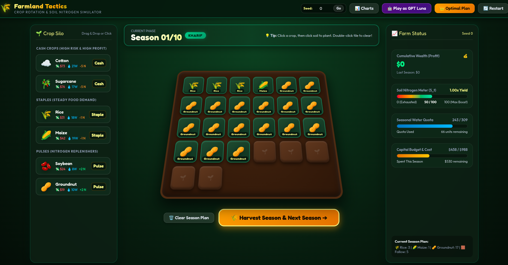

# Crop Rotation & Market POMDP Environment (NP-Hard Interactive Multi-Step Benchmark)

A reinforcement learning and agentic evaluation benchmark featuring a **Turn-by-Turn Sequential POMDP with Dynamic Soil Fertility & Macroeconomic Capital Compounding**, designed to test multi-step planning, long-horizon resource stewardship, and risk management in frontier LLMs without information leakage or reward hacking.


---

## 1. Primary Challenge: `crop_planning` (Multi-Step POMDP)

- **Task ID**: `crop_planning` (Default `DEMO_TASK`, Difficulty: **Hard**)
- **State Space**:
  - **Land Capacity ($A$)**: Integer discrete land cells ($A \in [20, 28]$ randomly seeded per instance).
  - **Planning Horizon ($T = 10$ Seasons)**: Alternates between **Kharif** (monsoon: seasons 1, 3, 5, 7, 9) and **Rabi** (winter: seasons 2, 4, 6, 8, 10).
  - **12 Crops partitioned by season**:
    - **Kharif Varieties**: `rice`, `maize`, `cotton`, `soybean`, `groundnut`, `sugarcane`
    - **Rabi Varieties**: `wheat`, `mustard`, `chickpea`, `barley`, `potato`, `lentil`
  - **Categorized Agronomic Profiles**:
    - **Cash Crops (`cotton`, `sugarcane`, `potato`)**: High input cost, high water requirement, massive profit booms (+40 to +110) or steep market losses, and heavy soil nitrogen drain ($-4$ to $-5$ per cell).
    - **Staples (`rice`, `maize`, `wheat`, `barley`)**: Steady demand, moderate cost, mild nitrogen depletion ($-1$ per cell).
    - **Pulses & Oilseeds (`soybean`, `groundnut`, `mustard`, `chickpea`, `lentil`)**: Low cost, low water, tight symmetric margins, actively **replenishes soil nitrogen** ($+2$ to $+3$ per cell).
  - **Dynamic Soil Nitrogen ($S_t \in [0, 100]$)**:
    - Starts at baseline fertility $S_1 = 50$.
    - **Natural Fallow Regeneration**: Every unplanted/idle cell naturally restores $+1$ nitrogen:
      $$S_{t+1} = \text{clamp}\left(S_t + \sum_k x_k \cdot \Delta_N(k) + (A - \sum x_k), 0, 100\right)$$
    - **Yield Multiplier**:
      $$Y(S_t) = \text{clamp}\left(0.4 + 0.6 \cdot \frac{S_t}{50.0}, 0.4, 1.6\right) \quad \text{if } S_t > 0 \text{ else } 0.0$$
      *(Bumper +60% bonus at $S=100$; heavy -48% penalty at $S=10$)*.
    - **Zero Nitrogen Lockout**: If soil fertility drops to $S \le 0$, the soil is exhausted: no crops can be planted next season. The agent is forced to allocate `{}` (all land idle) to let the soil recover.
  - **Compounding Capital Budget ($B_t$)**:
    - $100\%$ of season $t$'s net profit or loss directly compounds into season $t+1$'s working capital budget:
      $$B_{t+1} = \max(0, B_{\text{base}}(t+1) + \text{NetProfit}_t)$$
  - **Macroeconomic Market Prices**:
    - Wide stochastic price swings ($\pm 30\%$ to $\pm 80\%$) with cyclical demand waves and occasional cash crop booms.
    - ~45% of crop-seasons operate below seed input costs, penalizing reckless mono-cropping.

---

## 2. Anti-Cheat & Information Barrier Architecture

1. **Zero Files in Sandbox Workspace**:
   - Unlike standard coding benchmarks that leave problem files on disk, `crop_planning` gives the LLM an empty workspace:
     ```text
     list_files() -> (no files)
     ```
   - There is no `farm.py`, no compiled `.pyc` bytecode, and no precomputed solution file in the sandbox.
2. **Server-Side Native Tool Interception**:
   - The LLM interacts turn-by-turn strictly through the native tool:
     ```python
     plant_season(allocation='{"cotton": 6, "soybean": 14}')
     ```
   - The harness server intercepts the call in memory, enforces 3D constraints (Land $\le A$, Water $\le W_t$, Cost $\le B_t$), calculates revenue with current yield multiplier $Y(S_t)$, compounds capital, and reveals that round's true market prices in the tool response.
3. **Sequential POMDP Guarantee**:
   - At Turn 1, the LLM receives only historical price records for Season -1 and Season 0.
   - Future prices are revealed strictly turn-by-turn *after* each season is harvested. History cannot be rewritten retroactively.
4. **Isolated Docker Architecture**:
   - **Sandbox Container**: Runs model tool executions with no network access (`isolated` network).
   - **Harness Container**: Runs evaluator, PRNG master seed, and oracle solver on an isolated separate network. Secrets are never mounted to the sandbox.

---

## 3. Verifier & Provable Ground Truth Solver

- **100% Programmatic Evaluation (Zero LLM-as-judge)**.
- **Oracle DP Solver**:
  - The hidden evaluator solves the global multi-season Bellman backward induction across discrete soil nitrogen states and compounding working capital:
    $$V_t(S_t, \text{Cash}) = \max_{\text{alloc}} \left[ \text{Profit}(\text{alloc}, Y(S_t)) + V_{t+1}(S_{t+1}, \text{Cash} + \text{Profit}) \right]$$
  - Computes provable global optimum $\Pi^*$ in **$< 25\text{ ms}$**.
- **Scoring Tiers**:
  - **Optimal ($1.0$)**: Cumulative profit $\ge 90\%$ of global oracle $\Pi^*$.
  - **Good / Diversified ($0.67$)**: Cumulative profit $\ge 60\%$ of global oracle $\Pi^*$.
  - **Feasible Baseline ($0.33$)**: Valid plan respecting all constraints throughout all 10 seasons.
  - **Zero ($0.0$)**: Constraint overflow, unhandled lockout, or negative balance.

---

## 4. Secondary Task: `box_packing` (Combinatorial Optimization)

- **Task ID**: `box_packing` (Difficulty: **Hard**)
- **Formulation**: 3D Discrete Bin Packing with Spatial Item Incompatibility constraints.
- **Verification**: Exact branch-and-bound solver computing minimum bin count and item partitioning.

---

## 5. Quick Start & Execution

Requires Docker and Docker Compose v2.

### Step 1: Configure Environment
```bash
cp .env.example .env
# Set MODEL, API_KEY, and BASE_URL in .env
```

### Step 2: Run Baseline Gate Checks
Verify that the oracle passes ($\ge 0.95$) and no-op fails ($\le 0.05$):
```bash
MODE=baselines docker compose up --build --abort-on-container-exit --exit-code-from harness
```

### Step 3: Run Full Evaluation with Target Model
```bash
docker compose up --build --abort-on-container-exit --exit-code-from harness
```

### Step 4: Farmland Tactics Interactive Graphic Web App (Clash / FarmVille Style)
Experience the full 2D/3D interactive visualizer directly in your browser:
```bash
python3 play_gui.py
```
- **One-Command Launch**: Automatically starts the local server and opens `http://localhost:8080/visualizer.html` in your default browser.
- **3D Isometric Soil Grid**: Click-to-plant, drag-and-drop crop cards, double-click to remove.
- **Harvest & Settlement Modal**: Live yield multipliers, market prices, and soil fertility deltas.
- **Season History Charts**: Chart.js graphs tracking Cumulative Wealth, Soil Nitrogen Dynamics, and Crop Mix.
- **Optimal Strategy Solver**: Click "👑 Optimal Plan" to automatically populate the field with the theoretical DP schedule.
- **Play as GPT Luna**: Click "🤖 Play as GPT Luna" to load the model's exact moves or trigger an on-demand Docker Compose run for unrecorded seeds.
- **Final Campaign Scorecard**: Detailed end-game screen comparing your profit against the DP optimal ceiling with efficiency ratio and verifier rewards (0.00 / 0.33 / 0.67 / 1.00).

---

## 5. Run Contract & Limits

| Parameter | Specification |
| :--- | :--- |
| **Command** | `docker compose up --build --abort-on-container-exit --exit-code-from harness` |
| **Modes (`MODE`)** | `full` (gate checks then model on `TASK_ID`), `baselines` (checks only) |
| **Build Time** | $\sim 1.2$ seconds (fully cached, $< 1$ min fresh) |
| **Gate Check Time** | $< 2$ seconds (`gate_seconds` in `gate.json`) |
| **Per-Model Time Limit** | 10 minutes |
| **Step Limit** | 40 steps max |
| **Exit Codes** | `0` = Complete, `1` = Crash, `2` = Baseline gate failure, `3` = Bad config |
